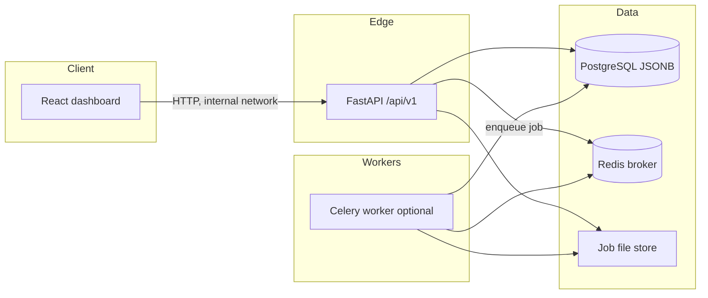

# SentinelAI XDR — Architecture

## Style

**Modular monolith.** One FastAPI process, one PostgreSQL database, one React SPA. Redis and Celery are optional workers for ingestion/detection jobs. No Kafka, Kubernetes, or Elasticsearch in the initial release.



## Runtime processes (Compose)

| Service | Role | Default bind |
|---------|------|----------------|
| `frontend` | Nginx serving the Vite production build | `127.0.0.1:8080` |
| `backend` | FastAPI + Uvicorn | `127.0.0.1:8000` |
| `worker` | Celery (ingestion + detection) | internal |
| `postgres` | PostgreSQL 16 | `127.0.0.1:5432` (dev only) |
| `db-provision` | One-shot setup of non-superuser application role | internal |
| `db-migrate` | One-shot Alembic schema upgrades using the schema-owner role | internal |
| `redis` | Broker / rate-limit backend | internal |

Compose publishes the dashboard, API, and PostgreSQL on **127.0.0.1**. The API and database are not intended to be exposed to a network. The API/worker use the `sentinel_runtime` role. A one-shot migration service receives the non-superuser schema-owner credential; the long-running API and worker do not receive it.

## Backend package layout

- `app/api/v1` — HTTP routers
- `app/core` — settings, security, logging
- `app/db` — engine, session, Alembic
- `app/models` — SQLAlchemy models
- `app/schemas` — Pydantic request/response
- `app/services` — application services
- `app/ingestion` — parsers, normalizers, adapters
- `app/detection` — rule engine + ML adapters
- `app/correlation` — grouping logic
- `app/cases` — case lifecycle
- `app/audit` — append-only audit records
- `app/workers` — Celery tasks and inline runner

## Data flow

1. Authenticated upload or ingestion-service token posts JSON/CSV (or adapter-specific logs).
2. API validates size, MIME/extension, row count, and schema; stores a job record.
3. Worker (or inline runner in tests) parses rows, quarantines invalid rows, normalizes, deduplicates, and inserts events.
4. Detection runners evaluate **enabled** rule versions against the new event window.
5. Optional ML scorer attaches anomaly scores; never blocks ingestion if the model is missing.
6. Correlation may attach detections to an existing open case or propose a new case.
7. Analysts investigate via the UI; all mutations are authorized and audited.

## Detection interface

All detectors implement:

```text
evaluate(events, context) -> list[DetectionCandidate]
```

Candidates include `detector_id`, `severity`, `title`, `evidence`, `mitre_attack` (optional, justified mappings only), and `confidence_note`.

Rule detections are the **reliable baseline**. Isolation Forest is experimental. XGBoost is used only when a labeled dataset and recorded evaluation exist.

## Trust boundaries

| Boundary | Trust |
|----------|--------|
| Browser | Untrusted |
| Imported logs / model output | Untrusted data, never instructions |
| FastAPI process | Trusted computing base for the lab |
| PostgreSQL | Trusted, least-privilege role |
| Redis | Trusted internal, no public bind |
| Celery tasks | Same trust as API; no `pickle` serializer |

## Organization boundary

Each user, sensor, source, ingestion job, event, detection, case, and audit record has an `organization_id`. Access tokens carry the organization selected at login. The API sets a transaction-local PostgreSQL context from the verified token; forced row-level security policies filter and constrain tenant-owned tables. Migration `005` assigns existing rows to the `default` organization. New organizations and their first administrator/rules are provisioned through `python -m app.core.tenants`. Runtime RLS protects against missing application query filters; it is not a defense against a fully compromised API process, and has not had independent security review.

## Persistence highlights

- UUID primary keys
- UTC timestamps
- JSONB for raw payload and flexible attributes
- Unique `dedup_key` where provided
- Indexes on `event_time`, `src_ip`, `host_id`, `event_type`, detection severity, case status
- Daily tenant-scoped retention job (02:15 UTC). It deletes security events in bounded batches by ingestion time and completed/failed import source files by job age, records each batch in the tenant audit log, and retains ingestion job metadata, detection snapshots, cases, and audit history. Source files default to 30 days and are configurable per organization; event telemetry defaults to 90 days.
- Optional protected, process-local Prometheus HTTP counters/histograms are exposed when a private metrics token is configured. Collection, durable metric storage, alerting, and delivery remain operator-provided.
- `scripts/backup.ps1` and `scripts/restore.ps1` cover PostgreSQL and the app-data volume, with checksummed manifests and a prompted restore. Recovery time and data-loss objectives still require an operator-run restore rehearsal.

## Frontend

Vite + React + TypeScript with project CSS. The SPA talks to `/api/v1` through the local Nginx proxy. Access tokens are held **in memory**; refresh tokens use an httpOnly cookie. There is no localStorage token store.

## Failure modes

- Worker down: jobs remain `queued`/`failed` with visible status; UI does not fake completion.
- Model missing: detectors skip ML and record `ml_status=unavailable`.
- Malformed rows: job completes with `accepted` + `quarantined` counts; details are queryable.
