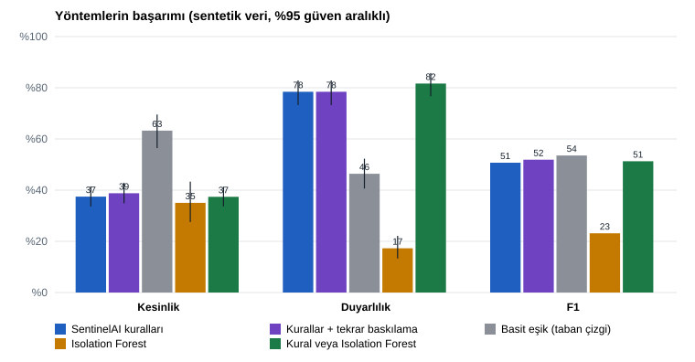
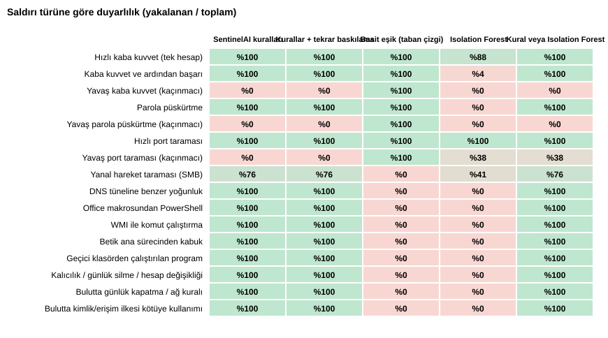
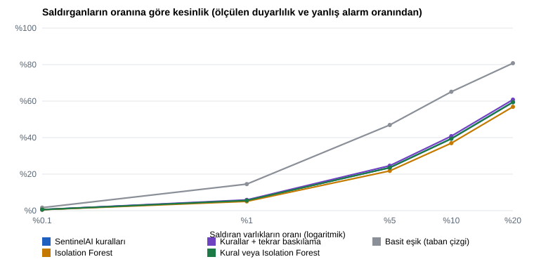
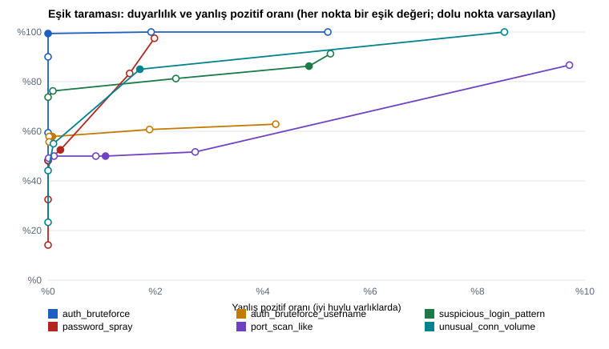

# SentinelAI XDR: tespit yöntemlerinin karşılaştırmalı değerlendirmesi

Üretim tarihi: 2026-11-14. Her sayı `research/` altındaki kodla yeniden üretilebilir (`python research/run_evaluation.py`).

## 1. Araştırma sorusu

SentinelAI XDR'daki tespit yöntemleri (şeffaf kurallar, basit eşikler, gözetimsiz makine öğrenmesi ve bunların birleşimi), etiketli bir veri üzerinde siber saldırı davranışlarını ne kadar doğru yakalıyor ve normal ama şüpheli görünen davranışlarda ne kadar yanlış alarm üretiyor?

## 2. Yöntem

- **Veri:** Tohumlu (tekrarlanabilir) bir simülatör, 500 varlıklık ağlar üretir ve her varlığa tek bir rol verir: 11 iyi huylu profilden biri veya 16 saldırı ailesinden biri. Varlık, bir kaynak IP adresi, bir Windows bilgisayarı veya bir bulut hesabıdır. Olaylar iki saatlik bir ufukta, tespit motorunun tükettiği biçimde yazılır.
- **Zor durumların payı (en önemli varsayım):** İyi huylu varlıkların %14'i saldırıya benzeyen davranış gösterir (ölçek 0.25); karşılaştırma için bölüm 6b'de %39 ile de ölçüldü.
- **Zor durumlar:** İyi huylu tarafta saldırıya benzeyen davranışlar (parolayı unutan kullanıcı, çok kullanıcılı NAT ağ geçidi, zamanlanmış güvenlik taraması, Office/WMI otomasyonu, Temp'ten çalışan kurulum, onaylı bulut değişikliği); saldırı tarafında eşiklerin altında kalmaya çalışan yavaş saldırılar.
- **Etiketleme birimi:** Varlık. Bir yöntem, varlığa ait olaylara dayanan bir bulgu ürettiyse o varlığı saldırgan olarak işaretlemiş sayılır.
- **Tekrar:** 20 bağımsız tohum; saldırgan oranı %10. Isolation Forest her tohumda varlıkların %70'i üzerinde, etiketsiz olarak eğitilir (contamination = 0.05) ve kalan %30 üzerinde değerlendirilir; diğer yöntemler eğitim gerektirmez ve aynı %30 üzerinde ölçülür.
- **Karşılaştırılan yöntemler:** (1) SentinelAI yerleşik kuralları, gerçek içe alım hattıyla aynı değerlendiriciler üzerinden; (2) basit eşik: tüm dönemde 10+ oturum açma hatası veya 20+ farklı hedef port; (3) Isolation Forest (projenin altı özellikli isteğe bağlı modeli); (4) kural veya Isolation Forest.
- **Metrikler:** Kesinlik (precision), duyarlılık (recall), F1, yanlış pozitif oranı (FPR); oranlar için %95 Wilson güven aralığı. Havuzlanmış sayılar kullanılır; tohumlar arası F1 standart sapması ayrıca verilir.

## 3. Ana sonuçlar

| Yöntem | Kesinlik | Duyarlılık | F1 | Yanlış pozitif oranı | TP | FP | FN | TN |
|---|---|---|---|---|---:|---:|---:|---:|
| SentinelAI kuralları | %37,5 [%33,6–%41,5] | %78,4 [%73,2–%82,8] | %50,7 (±8,0) | %13,4 [%12,2–%14,7] | 218 | 364 | 60 | 2358 |
| Kurallar + tekrar baskılama | %38,8 [%34,8–%42,9] | %78,4 [%73,2–%82,8] | %51,9 (±7,8) | %12,6 [%11,4–%13,9] | 218 | 344 | 60 | 2378 |
| Basit eşik (taban çizgi) | %63,2 [%56,4–%69,5] | %46,4 [%40,6–%52,3] | %53,5 (±8,8) | %2,8 [%2,2–%3,4] | 129 | 75 | 149 | 2647 |
| Isolation Forest | %35,0 [%27,6–%43,3] | %17,3 [%13,3–%22,1] | %23,1 (±9,4) | %3,3 [%2,7–%4,0] | 48 | 89 | 230 | 2633 |
| Kural veya Isolation Forest | %37,4 [%33,6–%41,3] | %81,7 [%76,7–%85,8] | %51,3 (±8,2) | %14,0 [%12,7–%15,3] | 227 | 380 | 51 | 2342 |

## 4. Saldırı türüne göre duyarlılık

| Saldırı türü | SentinelAI kuralları | Kurallar + tekrar baskılama | Basit eşik (taban çizgi) | Isolation Forest | Kural veya Isolation Forest |
|---|---|---|---|---|---|
| Hızlı kaba kuvvet (tek hesap) | %100,0 | %100,0 | %100,0 | %88,0 | %100,0 |
| Kaba kuvvet ve ardından başarı | %100,0 | %100,0 | %100,0 | %3,8 | %100,0 |
| Yavaş kaba kuvvet (kaçınmacı) | %0,0 | %0,0 | %100,0 | %0,0 | %0,0 |
| Parola püskürtme | %100,0 | %100,0 | %100,0 | %0,0 | %100,0 |
| Yavaş parola püskürtme (kaçınmacı) | %0,0 | %0,0 | %100,0 | %0,0 | %0,0 |
| Hızlı port taraması | %100,0 | %100,0 | %100,0 | %100,0 | %100,0 |
| Yavaş port taraması (kaçınmacı) | %0,0 | %0,0 | %100,0 | %37,5 | %37,5 |
| Yanal hareket taraması (SMB) | %76,5 | %76,5 | %0,0 | %41,2 | %76,5 |
| DNS tüneline benzer yoğunluk | %100,0 | %100,0 | %0,0 | %0,0 | %100,0 |
| Office makrosundan PowerShell | %100,0 | %100,0 | %0,0 | %0,0 | %100,0 |
| WMI ile komut çalıştırma | %100,0 | %100,0 | %0,0 | %0,0 | %100,0 |
| Betik ana sürecinden kabuk | %100,0 | %100,0 | %0,0 | %0,0 | %100,0 |
| Geçici klasörden çalıştırılan program | %100,0 | %100,0 | %0,0 | %0,0 | %100,0 |
| Kalıcılık / günlük silme / hesap değişikliği | %100,0 | %100,0 | %0,0 | %0,0 | %100,0 |
| Bulutta günlük kapatma / ağ kuralı | %100,0 | %100,0 | %0,0 | %0,0 | %100,0 |
| Bulutta kimlik/erişim ilkesi kötüye kullanımı | %100,0 | %100,0 | %0,0 | %0,0 | %100,0 |

## 5. İyi huylu davranışlarda yanlış alarm oranı

| İyi huylu rol | SentinelAI kuralları | Kurallar + tekrar baskılama | Basit eşik (taban çizgi) | Isolation Forest | Kural veya Isolation Forest |
|---|---|---|---|---|---|
| Sıradan iş istasyonu | %0,0 | %0,0 | %0,0 | %0,0 | %0,0 |
| Parolayı unutan kullanıcı | %81,4 | %81,4 | %0,0 | %0,0 | %81,4 |
| Sunucu | %0,0 | %0,0 | %0,0 | %5,4 | %5,4 |
| NAT ağ geçidi (çok kullanıcılı) | %100,0 | %100,0 | %100,0 | %100,0 | %100,0 |
| Zamanlanmış güvenlik tarayıcısı | %100,0 | %100,0 | %100,0 | %93,1 | %100,0 |
| DNS çözümleyici | %0,0 | %0,0 | %0,0 | %0,0 | %0,0 |
| Sıradan uç nokta (süreçler) | %0,0 | %0,0 | %0,0 | %0,0 | %0,0 |
| Yönetici otomasyonu (Office/WMI/betik) | %100,0 | %80,8 | %0,0 | %0,0 | %100,0 |
| Kurulum programı (Temp/İndirilenler) | %100,0 | %100,0 | %0,0 | %0,0 | %100,0 |
| Onaylı bulut değişikliği | %100,0 | %100,0 | %0,0 | %0,0 | %100,0 |
| Bulut salt okuma | %0,0 | %0,0 | %0,0 | %0,0 | %0,0 |

## 6. Saldırgan oranı değişirse kesinlik

Gerçek ağlarda saldıran varlık oranı çok düşüktür ve kesinlik bu orana bağlıdır; duyarlılık ve yanlış pozitif oranı bağlı değildir. Aşağıdaki tablo, ölçülen duyarlılık ve yanlış pozitif oranından hesaplanmış **projeksiyondur** (ölçüm değildir).

| Yöntem | %0.1 | %1 | %5 | %10 | %20 |
|---|---:|---:|---:|---:|---:|
| SentinelAI kuralları | %0,6 | %5,6 | %23,6 | %39,5 | %59,5 |
| Kurallar + tekrar baskılama | %0,6 | %5,9 | %24,6 | %40,8 | %60,8 |
| Basit eşik (taban çizgi) | %1,7 | %14,5 | %46,9 | %65,1 | %80,8 |
| Isolation Forest | %0,5 | %5,1 | %21,8 | %37,0 | %56,9 |
| Kural veya Isolation Forest | %0,6 | %5,6 | %23,5 | %39,4 | %59,4 |

## 6b. Zor durumların payı değişirse

Aynı simülasyon, iyi huylu varlıkların %14'i (ana senaryo) ve %39'i (stres senaryosu) saldırıya benzeyen davranış gösterecek şekilde çalıştırıldı:

| Yöntem | F1 (ana) | FPR (ana) | F1 (stres) | FPR (stres) |
|---|---:|---:|---:|---:|
| SentinelAI kuralları | %50,7 | %13,4 | %28,5 | %38,0 |
| Kurallar + tekrar baskılama | %51,9 | %12,6 | %29,6 | %35,9 |
| Basit eşik (taban çizgi) | %53,5 | %2,8 | %40,8 | %8,3 |
| Isolation Forest | %23,1 | %3,3 | %10,0 | %5,1 |
| Kural veya Isolation Forest | %51,3 | %14,0 | %28,5 | %38,0 |

## 7. Hangi kural nerede doğru, nerede yanlış?

Her kuralın, değerlendirme kümesinde kaç saldıran ve kaç iyi huylu varlık için bulgu ürettiği (havuzlanmış, tüm tohumlar):

| Kural | Saldıran varlık | İyi huylu varlık (yanlış alarm) |
|---|---:|---:|
| `suspicious_login_pattern` | 23 | 127 |
| `auth_bruteforce` | 63 | 0 |
| `unusual_conn_volume` | 22 | 37 |
| `auth_bruteforce_username` | 48 | 2 |
| `cscript_spawns_powershell` | 8 | 37 |
| `wscript_spawns_powershell` | 6 | 38 |
| `wmi_spawns_cmd` | 12 | 30 |
| `aws_iam_credential_or_policy_change` | 13 | 28 |
| `port_scan_like` | 9 | 31 |
| `office_spawns_powershell` | 8 | 30 |
| `wmi_spawns_powershell` | 7 | 29 |
| `process_from_downloads_folder` | 6 | 26 |
| `excel_spawns_powershell` | 6 | 25 |
| `outlook_spawns_powershell` | 5 | 26 |
| `process_from_temp_folder` | 5 | 24 |
| `powerpnt_spawns_powershell` | 2 | 23 |
| `azure_role_assignment_change` | 0 | 24 |
| `password_spray` | 13 | 8 |
| `suspicious_traffic_dns` | 13 | 0 |
| `process_from_public_folder` | 10 | 0 |
| `azure_diagnostic_logging_deleted` | 6 | 0 |
| `azure_network_security_rule_changed` | 6 | 0 |
| `mshta_spawns_powershell` | 6 | 0 |
| `windows_audit_policy_changed` | 5 | 0 |
| `windows_scheduled_task_changed` | 5 | 0 |
| `aws_cloudtrail_logging_tampered` | 3 | 0 |
| `windows_account_created` | 3 | 0 |
| `windows_scheduled_task_created` | 3 | 0 |
| `windows_security_log_cleared` | 2 | 0 |
| `windows_service_installed` | 1 | 0 |

## 8. Eşik duyarlılık analizi (kural başına)

Her kuralın tek bir eşiği değiştirildi; duyarlılık yalnızca kuralın hedeflediği saldırı ailelerinde, yanlış pozitif oranı tüm iyi huylu varlıklarda ölçüldü. Varsayılan eşik **kalın** gösterilir. Eşiği bu veriye göre "en iyi" seçmek döngüsel olurdu; tablo yalnızca ödünleşimi gösterir.

**`auth_bruteforce`** (`threshold`; hedef: Hızlı kaba kuvvet (tek hesap), Kaba kuvvet ve ardından başarı)

| Eşik | Duyarlılık | Yanlış pozitif oranı |
|---:|---:|---:|
| 3 | %100,0 | %5,2 [%4,8–%5,7] |
| 5 | %100,0 | %1,9 [%1,7–%2,2] |
| **8** | %99,4 | %0,0 [%0,0–%0,0] |
| 12 | %90,0 | %0,0 [%0,0–%0,0] |
| 20 | %59,4 | %0,0 [%0,0–%0,0] |
| 40 | %48,1 | %0,0 [%0,0–%0,0] |

**`auth_bruteforce_username`** (`threshold`; hedef: Hızlı kaba kuvvet (tek hesap), Yavaş kaba kuvvet (kaçınmacı))

| Eşik | Duyarlılık | Yanlış pozitif oranı |
|---:|---:|---:|
| 3 | %62,9 | %4,2 [%3,9–%4,7] |
| 5 | %60,7 | %1,9 [%1,6–%2,2] |
| **10** | %57,9 | %0,1 [%0,0–%0,2] |
| 20 | %57,9 | %0,0 [%0,0–%0,1] |
| 40 | %55,7 | %0,0 [%0,0–%0,1] |

**`suspicious_login_pattern`** (`min_failures`; hedef: Kaba kuvvet ve ardından başarı)

| Eşik | Duyarlılık | Yanlış pozitif oranı |
|---:|---:|---:|
| 2 | %91,2 | %5,3 [%4,8–%5,7] |
| **3** | %86,2 | %4,9 [%4,4–%5,3] |
| 5 | %81,2 | %2,4 [%2,1–%2,7] |
| 8 | %76,2 | %0,1 [%0,1–%0,2] |
| 12 | %73,8 | %0,0 [%0,0–%0,0] |

**`password_spray`** (`threshold`; hedef: Parola püskürtme, Yavaş parola püskürtme (kaçınmacı))

| Eşik | Duyarlılık | Yanlış pozitif oranı |
|---:|---:|---:|
| 3 | %97,5 | %2,0 [%1,7–%2,3] |
| 4 | %83,3 | %1,5 [%1,3–%1,8] |
| **6** | %52,5 | %0,2 [%0,1–%0,4] |
| 8 | %48,3 | %0,0 [%0,0–%0,0] |
| 12 | %32,5 | %0,0 [%0,0–%0,0] |
| 16 | %14,2 | %0,0 [%0,0–%0,0] |

**`port_scan_like`** (`threshold`; hedef: Hızlı port taraması, Yavaş port taraması (kaçınmacı))

| Eşik | Duyarlılık | Yanlış pozitif oranı |
|---:|---:|---:|
| 5 | %86,7 | %9,7 [%9,1–%10,3] |
| 8 | %51,7 | %2,7 [%2,4–%3,1] |
| **12** | %50,0 | %1,1 [%0,9–%1,3] |
| 20 | %50,0 | %0,9 [%0,7–%1,1] |
| 40 | %50,0 | %0,1 [%0,1–%0,2] |
| 80 | %49,2 | %0,0 [%0,0–%0,1] |

**`unusual_conn_volume`** (`threshold`; hedef: Yanal hareket taraması (SMB), Hızlı port taraması)

| Eşik | Duyarlılık | Yanlış pozitif oranı |
|---:|---:|---:|
| 20 | %100,0 | %8,5 [%7,9–%9,1] |
| **40** | %85,0 | %1,7 [%1,5–%2,0] |
| 80 | %55,0 | %0,1 [%0,1–%0,2] |
| 160 | %44,2 | %0,0 [%0,0–%0,0] |
| 320 | %23,3 | %0,0 [%0,0–%0,0] |

## 9. Isolation Forest duyarlılık analizi

| contamination | Kesinlik | Duyarlılık | F1 | FPR |
|---|---|---|---|---|
| 0.01 | %12,5 | %1,1 | %2,0 | %0,8 |
| 0.05 | %35,0 | %17,3 | %23,1 | %3,3 |
| 0.15 | %27,9 | %45,0 | %34,4 | %11,9 |

## 10. Sınırlılıklar (okumadan önce)

- **Veri sentetiktir.** İyi huylu ve kötü amaçlı davranışın nasıl göründüğü varsayımı simülatörü yazanlara aittir ve kurallar da aynı kişilerce yazılmıştır; bu, kurallar lehine bir yanlılık yaratır. Sonuçlar "bu varsayımlar altında davranış"ı ölçer, gerçek bir ağdaki yanlış alarm oranını değil.
- **Etiket birimi varlıktır, olay değil.** Bir saldırganın tek bir olayını yakalamak varlığı yakalanmış sayar; saldırının ne kadarının görüldüğü ölçülmez.
- **Parametreler ayarlanmadı.** Kural eşikleri ve Isolation Forest ayarları ne bu veriye göre seçildi ne de optimize edildi; bu nedenle sonuçlar bir üst sınır değildir.
- **Bulut ve uç nokta olayları** Isolation Forest ve basit eşik için görünmezdir (bu özellikler yalnızca oturum açma ve ağ sayımlarını kullanır). Bu, yöntemlerin eşit koşulda karşılaştırıldığı anlamına gelmez; kurallar daha fazla veri türünü görür.
- **Etiketli gerçek veri yok.** İyi huylu ve saldırı etiketli bir gerçek veri kümesiyle ölçüm yapılmadı; kod `--dataset` ile bunu alacak biçimde hazırdır. Yalnızca saldırı içeren sekiz halka açık Windows kaydında kuralların duyarlılığı ayrıca denendi (GERCEK_VERI.md); orada yanlış alarm ölçülemez.
- **Tek koşullu dönem:** İki saatlik ufuk ve sabit pencere hizalaması; pencere sınırını aşan yavaş saldırılar bu nedenle daha da zor yakalanır.
